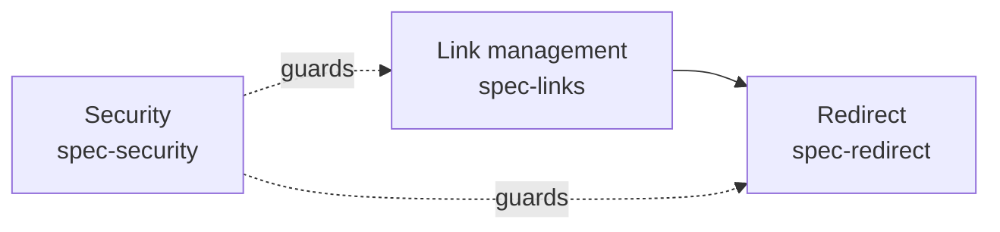

# Requirement Analysis

## 1. Method
Each statement in the brief was classified as Mandate, Tunable number, Illustration, Rationale or Assumption. "About 6 characters", "under 50 ms" and "a year" are **tunable numbers** and became policy values.

## 2. Capability map

## 3. Breakdown: source → capability → spec → phase
| # | Source section | Key mandates extracted | Spec | Phase |
|---|---|---|---|---|
| 1 | section 1 Problem | Ticket volume | Intent H-1 | P0 |
| 2 | section 2 bullets 1, 6, 7 | Create, custom alias, expiry, alias length | spec-links | P1–P2 |
| 3 | section 2 bullets 2, 5 | Fast redirect, click counts without identity | spec-redirect | P1–P2 |
| 4 | section 2 bullets 3, 4 | SSO to create, http(s) only | spec-security | P1 |
| 5 | section 3 Success | Baseline first, 30% reduction | validation-design | P0, P3 |
| 6 | section 4 Assumptions | Kubernetes, Python | ADR-0001, ADR-0002 | — |

## 4. Derived requirements
| ID | Derived requirement | Derived from |
|---|---|---|
| D-1 | Unknown or expired aliases need a defined response | section 2 bullets 2 and 6 |
| D-2 | Custom aliases can collide and need a defined rejection | section 2 bullet 1 |

## 5. Risks
| ID | Risk | Likelihood | Impact | Mitigation |
|---|---|---|---|---|
| R-1 | Alias guessing exposes internal URLs | M | M | Internal network only (NG-1); auth on create |
| R-2 | Baseline ticket data is incomplete | M | H | P0 exit criterion requires 2 full months |

## 6. Open questions
| ID | Question | Blocks | Proposed default | Status |
|---|---|---|---|---|
| OQ-1 | Can a creator delete a link before it expires? | P2 | No; expiry only | Open |
