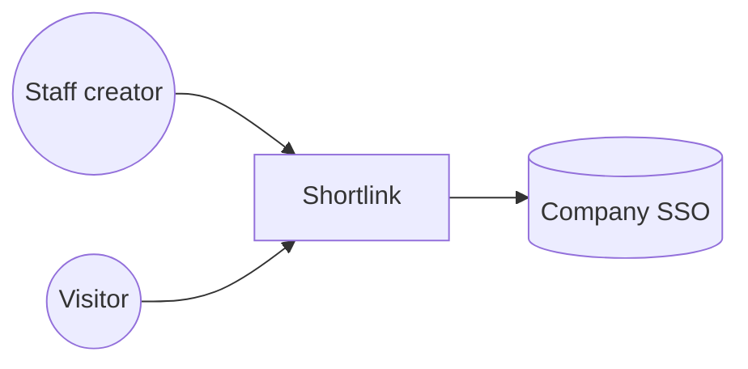
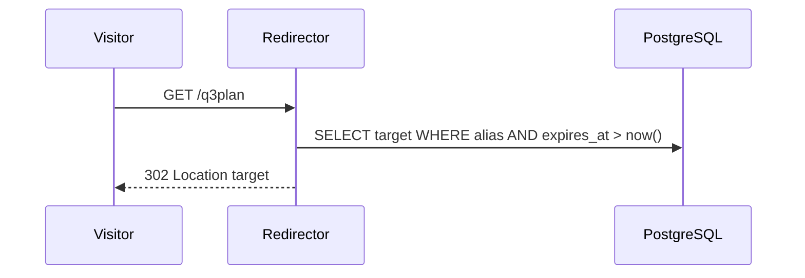

# Shortlink Architecture

## 1. Context (C4 L1)


## 2. Containers (C4 L2)
| Container | Responsibility | Specs |
|---|---|---|
| Web API | Link Service and Redirector endpoints | LNK, RED, SEC |
| PostgreSQL | Links and click counters | LNK, RED |

## 3. Components and dependency rules
1. The Redirector never calls SSO. Redirects are anonymous by design.
2. Only the Link Service writes to `link`. The Redirector only reads `link` and increments `click_count`.
3. Domain code does not import web-framework or database modules. An architecture test enforces this.

## 4. Key runtime flow: redirect


## 5. Solution layout
```text
src/shortlink/{domain,api,storage}/  tests/
```

## 6. Technology choices
| Concern | Choice | ADR |
|---|---|---|
| Runtime and stack | Python 3.13 | [ADR-0001](./adr/ADR-0001-python-stack.md) |
| Storage | PostgreSQL 17 | [ADR-0002](./adr/ADR-0002-postgresql.md) |
| Authentication | OIDC via company SSO on create only | [ADR-0003](./adr/ADR-0003-auth-on-create-only.md) |
