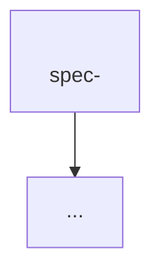

# Mise en place: blueprint templates

Replace `<…>` placeholders. Inside the blueprint, use relative links, and link only to files that already exist (the link checker runs on partial blueprints too). Keep documents table-first and concise. All IDs, statuses and gate values come from [vocabulary.md](./vocabulary.md).

---

## `<blueprint>/README.md`

```markdown
# <Project> <Blueprint>

This folder is the **blueprint of <Project>**: the single source of truth for *why* it exists, *what* it must do and *how* it is designed. Code, tests and customisations are downstream. If they disagree with it, either the <blueprint> is updated deliberately or the code is wrong.

## Layout
| Layer | Folder | Answers | Changes when |
|---|---|---|---|
| Source | [<source>.md](./<source>.md) | Original requirement | Never edited |
| 0. Intent | [00-intent/](./00-intent/) | Why, hypothesis, goals, non-goals, principles | Vision changes |
| 1. Analysis | [01-analysis/](./01-analysis/) | Breakdown, gaps, risks, open questions, glossary | New understanding |
| 2. Specs | [02-specs/](./02-specs/) | What each capability must do (EARS + IDs) | Behaviour changes |
| 3. Design | [03-design/](./03-design/) | Architecture, data, contracts, ADRs | Structural decision |
| 4. Plan | [04-plan/](./04-plan/) | Phases, exit criteria, backlog | Scope or sequence changes |
| 5. Validation | [05-validation/](./05-validation/) | How success is proven | Validation policy changes |
| Traceability | [traceability.md](./traceability.md) | Source → spec → design → plan | Any spec or design change |

## Reading order
1. Intent → 2. Analysis + glossary → 3. Spec index + relevant spec → 4. Architecture + ADRs → 5. Roadmap

## Rules
1. The source document is never edited.
2. Every requirement has a stable ID, never reused or renumbered.
3. Every implementation change traces to a requirement ID.
4. Structural decisions are ADRs.
5. Unknowns are explicit (assumption table or OQ-n).
6. Specs describe behaviour, not implementation.
7. Numbers are hypotheses (policy values).

## Status
| Item | Value |
|---|---|
| Stage | Layout and planning |
| Mode | New / Existing codebase |
| Mise-en-place step | <n> of 12 |
| Requirement budget | <live> / <N> |
| Gates | Analysis <g> · Specs <g> · Design and plan <g> |
| Current phase | P0 |
| Stack | <stack> |
| Owner | <owner> |

Gate values: see [vocabulary.md](./vocabulary.md#gates).

## Decisions from clarification
Used until the intent's constraints table exists (step 4), then kept as a log.
| Question | Answer | Status |
|---|---|---|

## Change log
| CR | Date | Step | Gate | Summary |
|---|---|---|---|---|
```

Create this README at the end of step 1, with a Layout table that lists only the layers that exist so far. Add rows as each layer is written.

---

## `00-intent/intent.md`

```markdown
---
id: INTENT-001
title: <Project> — Product Intent
status: Draft
version: 0.1.0
source: ../<source>.md
---

# <Project>: Product Intent

## 1. Vision
<2–3 sentences + a one-line tagline>

## 2. Problem statement
- **<Problem>.** <why it hurts>

## 3. Core hypothesis / value proposition
> **H-1:** <testable statement with a measurable outcome>

## 4. Goals
| ID | Goal | Measured by |
|---|---|---|
| G-1 | | |

## 5. Non-goals
| ID | Non-goal | Rationale |
|---|---|---|
| NG-1 | | |

## 6. Actors
| Actor | Description |
|---|---|

## 7. Guiding principles
1. **<Principle>.** <one line>

## 8. Confirmed constraints and assumptions
| Constraint | Decision | Status |
|---|---|---|
| Stack | | Confirmed by owner / Default accepted / Assumed from source / Recorded from code |

Status values: Confirmed by owner · Default accepted · Assumed from source · Recorded from code.

## 9. Primary success measure
<formula or KPI definition>
```

---

## `01-analysis/requirement-analysis.md`

```markdown
---
id: ANALYSIS-001
title: Requirement Analysis and Breakdown
status: Draft
version: 0.1.0
source: ../<source>.md
---

# Requirement Analysis

## 1. Method
Statements were classified as Mandate → requirement, Tunable number → policy value, Illustration → design input, Rationale → ADR or principle, and Assumption → constraint or OQ.

## 2. Capability map


## 3. Breakdown: source → capability → spec → phase
| # | Source section | Key mandates extracted | Spec | Phase |
|---|---|---|---|---|

## 4. Derived (implicit) requirements
| ID | Derived requirement | Derived from |
|---|---|---|
| D-1 | | |

## 5. Risks
| ID | Risk | Likelihood | Impact | Mitigation |
|---|---|---|---|---|
| R-1 | | | | |

## 6. Open questions
| ID | Question | Blocks | Proposed default | Status |
|---|---|---|---|---|
| OQ-1 | | | | Open / Resolved: <decision> (<gate or CR>, DD-MM-YYYY) |
```

> Items found after a gate (a new D-n, R-n or OQ-n) are appended with "(added at step n)" or "(added by CR-NNN)" and shown at the next gate. Approved rows are never deleted.

## `01-analysis/glossary.md`

```markdown
# Glossary
| Term | Definition |
|---|---|
```

---

## `02-specs/README.md`

```markdown
# Specifications Index

Specs define observable behaviour. Classes, libraries and schemas belong in design.

## Spec catalogue
| Prefix | Spec | Component | First phase |
|---|---|---|---|

## Conventions
### Requirement IDs
`<FR|NFR>-<PREFIX>-<NNN>`, never reused or renumbered. Withdrawn requirements stay in the table, with "Withdrawn: <reason or replacement ID>" in the requirement text.

### EARS patterns
| Pattern | Template |
|---|---|
| Ubiquitous | The `<component>` shall `<response>`. |
| Event-driven | **When** `<trigger>`, the `<component>` shall `<response>`. |
| State-driven | **While** `<state>`, the `<component>` shall `<response>`. |
| Unwanted | **If** `<condition>`, **then** the `<component>` shall `<response>`. |
| Optional | **Where** `<feature>`, the `<component>` shall `<response>`. |

### Attributes
Priority M/S/C/W · Phase P0–Pn · Status Draft → Agreed → Implemented → Verified / Withdrawn · Source (§ or D-n)

### Acceptance criteria
`AC-<PREFIX>-<NNN>.<n>` in Given/When/Then form. Required for a Must to move from Draft to Agreed. Test names include the AC ID.

### Policy values
`policy:<key>` = default. Configuration, changed only with evidence.
```

## `02-specs/spec-<capability>.md`

```markdown
---
id: SPEC-<PREFIX>
title: <Capability>
status: Draft
version: 0.1.0
phase: P<n>
source: ../<source>.md §<section>
---

# <Capability>

## 1. Purpose
## 2. Scope
**In:** … **Out:** … (with links to the owning spec)
## 3. Actors and interfaces
## 4. Functional requirements
| ID | Requirement | Pri | Phase | Source | Status |
|---|---|---|---|---|---|
| FR-<PREFIX>-001 | When <trigger>, the <Component> shall <response>. | M | P1 | §<section> | Draft |
## 5. Non-functional requirements
| ID | Requirement | Pri | Status |
|---|---|---|---|
| NFR-<PREFIX>-001 | | M | Draft |
## 6. Acceptance criteria
- **AC-<PREFIX>-001.1**: *Given* …, *when* …, *then* …. Needs: <FR-/NFR- IDs of other requirements the AC relies on, if any; the script rejects later-phase ones>
- **AC-NFR-<PREFIX>-001.1**: *Given* …, *when* …, *then* ….
## 7. Policy values
- `policy:<key>` = <default>
## 8. Open questions and dependencies
```

> The register generator detects rows starting with `| FR-XXX-NNN |` or `| NFR-XXX-NNN |`. FR columns: ID, Requirement, Pri, Phase, Source, Status. NFR columns: ID, Requirement, Pri, Status, with the phase taken from the front matter `phase:`. Keep this column order.
>
> Status values and their meaning: [vocabulary.md](./vocabulary.md#requirement-status). Withdrawn rows are kept and excluded from the gates and the budget.

---

## `03-design/architecture.md`

```markdown
# <Project> Architecture
## 1. Context (C4 L1)        — mermaid flowchart: actors, the system, external systems
## 2. Containers (C4 L2)     — mermaid + table: container | responsibility | specs
## 3. Components and dependency rules — mermaid + numbered, test-enforceable rules
## 4. Key runtime flows      — mermaid sequenceDiagram per critical flow
## 5. Solution layout        — folder tree
## 6. Technology choices     — table: concern | choice | ADR
## 7. Deployment
```

## `03-design/data-model.md`

```markdown
# Data Model
## 1. Principles  — keys, timestamps, mutability (append-only?), secrets
## 2. Entity overview — mermaid erDiagram
## 3. Tables — SQL/DDL draft; mark additions beyond the source with ➕
## 4. Indexes
## 5. Derived views
```

## `03-design/<interface>-contracts.md`

```markdown
# <Interface> Contracts
Per operation: name · purpose · spec IDs · input schema · output schema · read-only or mutating · guardrails
## Later operations (phase)
## Forbidden operations
```

## `03-design/adr/ADR-NNNN-<title>.md`

```markdown
# ADR-NNNN: <Decision>
- **Status:** Proposed | Accepted (confirmed by owner, DD-MM-YYYY) | Accepted (recorded retrospectively, DD-MM-YYYY) | Superseded by ADR-XXXX
- **Amends:** ADR-XXXX (only when extending an accepted ADR without contradicting it)
- **Date:** DD-MM-YYYY
- **Specs:** SPEC-<PREFIX>, FR-…
## Context
## Decision
## Alternatives considered   — at least two real options, each with why it was not chosen
## Consequences
```

`adr/README.md` is an index table: ADR · Title · Status.

---

## `04-plan/roadmap.md`

```markdown
# Roadmap
Principle: build the smallest measurable system first.
| Phase | Name | Deliverable | Exit criterion | Specs |
|---|---|---|---|---|
## Schedule (mermaid gantt, if dates are known)
## Phase gates
1. Exit criterion demonstrated. 2. All phase Musts Implemented + ACs passing. 3. Blocking OQs resolved or defaulted. 4. Traceability updated.
```

## `04-plan/backlog.md`

```markdown
# Backlog
## P0: <name>
| ID | Item | Satisfies | Done when |
|---|---|---|---|
| <ABBR>-0-01 | | FR-… | AC-… passes |
<!-- <ABBR> = 2–4 letter project abbreviation, the same for all items (for example, SL for Shortlink) -->
## P1: <name>
## P2+ (epics)
```

> The register generator reads rows starting with `| <ABBR>-<phase>-<nn> |` and every `FR-`/`NFR-` ID in them. It fails if an item is in an earlier phase than a requirement it satisfies, or cites an unknown ID.

---

## `05-validation/validation-design.md`

```markdown
# Validation Design
## 1. Question
## 2. Hypotheses (H-n, each with a comparison)
## 3. Treatments / scenarios
## 4. Dataset / benchmark / UAT scenarios
## 5. Protocol (pairing, repetitions, randomisation, isolation)
## 6. Recorded per run
## 7. Pre-registered success criteria (policy values)
## 8. Analysis method
## 9. Threats to validity
```

---

## `traceability.md`

```markdown
# Traceability Matrix
Regenerate §3 with the traceability-audit skill. Do not hand-edit it.

## 1. Source → intent
| Source theme | Intent element |
|---|---|

## 2. Spec → design → plan
| Spec | Design artifacts | ADRs | Phases | Backlog |
|---|---|---|---|---|

## 3. Requirement register
```

---

## `changes/CR-NNN-<title>.md` (Change mode)

```markdown
---
id: CR-NNN
title: <short title>
date: DD-MM-YYYY
requested_by: <name or role>
status: Draft | Approved (DD-MM-YYYY) | Applied
---

# CR-NNN: <title>

## Request (verbatim, never edited)
> <the user's words>

## Impact
| Layer | Impact | Files |
|---|---|---|
| Intent | | |
| Analysis | OQs resolved / D, R, OQ added | |
| Specs | New: … · Withdrawn: … · Clarified: … | |
| Design | | |
| ADRs | New / supersedes / amends / none (why) | |
| Plan | Phase P<n>, backlog items … | |
| Customisations | None / … | |

## Decisions taken
| Question | Decision | Status |
|---|---|---|
```
